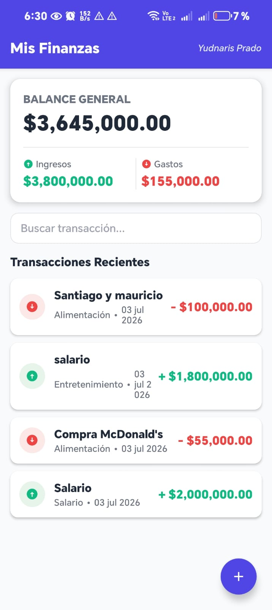
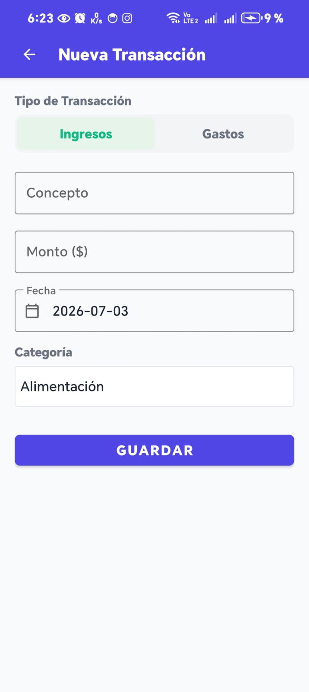

# Mis Finanzas - Gestor de Gastos Personales

Aplicación nativa para la plataforma Android desarrollada en **Java**, diseñada para la gestión integral de finanzas personales. Este repositorio contiene la documentación completa y el código fuente correspondiente a las entregas de **Momento 1**, **Momento 2** y **Momento 3 (Proyecto Integrador Final)**.

**Estudiante:** Yudnaris Maria Prado Robles  
**Asignatura:** Desarrollo de Aplicaciones Móviles (Android Nativo)  
**Plataforma:** Android 7.0+ (API level 24+) | Java 17 | Firebase (Auth, Firestore, Cloud Messaging) — todo en el plan gratuito Spark | Google Maps SDK  

---

## 💡 Problema que soluciona

Muchas personas no saben en qué se les va el dinero: anotan gastos en papel o en notas del celular, pierden los recibos y no recuerdan dónde hicieron cada compra. **Mis Finanzas** centraliza los ingresos y gastos en la nube y le agrega a cada movimiento la **foto del comprobante** y el **lugar donde ocurrió**, de modo que el usuario puede:

- Ver su balance (ingresos − gastos) actualizado en tiempo real en cualquier dispositivo.
- Guardar la evidencia (factura, recibo, tiquete) sin miedo a perderla.
- Ver en un **mapa** dónde gasta su dinero.
- Recibir una **notificación** cada vez que se registra o modifica un movimiento.

Pensada también para pequeños negocios o familias: un **Administrador** supervisa los movimientos de todos los usuarios y es el único que puede eliminarlos; los usuarios **Estándar** solo gestionan los suyos.

---

## 🔑 Credenciales de prueba

| Rol | Correo | Contraseña | Permisos |
| :--- | :--- | :--- | :--- |
| 👑 Administrador | `admin@misfinanzas.com` | `Admin123456*` | Ve las transacciones de **todos** los usuarios (con el correo del dueño) y puede **eliminarlas**. |
| 👤 Estándar | `usuario@misfinanzas.com` | `User123456*` | Ve, crea y edita **solo sus** transacciones. No puede eliminar. |

> Son cuentas exclusivas para la evaluación del proyecto.

---

## 🏁 Momento 3: Aplicación Móvil Completa

### A. 🔐 Seguridad y Control de Acceso (Auth + RBAC + Sesión)
- **Autenticación en la nube:** registro e inicio de sesión con `FirebaseAuth` (correo y contraseña) en [`LoginActivity.java`](app/src/main/java/com/misfinanzas/gestorgastos/LoginActivity.java) y [`RegisterActivity.java`](app/src/main/java/com/misfinanzas/gestorgastos/RegisterActivity.java). Los errores de Firebase se traducen a mensajes claros en español ([`AuthErrors.java`](app/src/main/java/com/misfinanzas/gestorgastos/util/AuthErrors.java)).
- **Control de sesión:** [`SessionManager.java`](app/src/main/java/com/misfinanzas/gestorgastos/session/SessionManager.java) guarda uid, nombre, correo y rol en `SharedPreferences`. Al abrir la app, si la sesión sigue activa se hace **Auto-Login** directo a la pantalla principal.
- **Cierre de sesión seguro:** el botón de logout detiene los listeners, invalida el token push, ejecuta `FirebaseAuth.signOut()` (destruye el token), limpia `SharedPreferences`, la caché de imágenes de Glide y las notificaciones, y redirige al Login borrando el historial de pantallas.
- **Roles (RBAC):** el perfil `usuarios/{uid}` en Firestore tiene el campo `rol` (`admin` / `estandar`).
  - En la interfaz: el Administrador ve la lista global con el dueño de cada registro y el botón **Eliminar**; el Estándar solo ve lo suyo y un aviso de que no puede eliminar.
  - En el servidor: [`firestore.rules`](firestore.rules) hace cumplir los mismos permisos, por lo que no se pueden saltar modificando la app. Nadie puede asignarse el rol de administrador a sí mismo.

### B. 🖼️ Datos y Multimedia (Firestore + Glide)
- **CRUD en tiempo real** con `addSnapshotListener`, filtrado por rol ([`FirestoreManager.java`](app/src/main/java/com/misfinanzas/gestorgastos/database/FirestoreManager.java)).
- **Captura multimedia** en [`TransactionFormActivity.java`](app/src/main/java/com/misfinanzas/gestorgastos/TransactionFormActivity.java) con `ActivityResultLauncher`:
  - Cámara: `TakePicture` + `FileProvider`, solicitando el permiso `CAMERA` en tiempo de ejecución (con explicación y acceso a Ajustes si se niega).
  - Galería: selector moderno de fotos `PickVisualMedia`.
- **Subida a la nube:** la foto se reduce y corrige su rotación ([`ImageUtils.java`](app/src/main/java/com/misfinanzas/gestorgastos/util/ImageUtils.java)), se comprime a un máximo de ~250 KB, se codifica en Base64 como *data URI* y se guarda en la nube dentro del documento de la transacción en Cloud Firestore, con **barra de progreso** ([`ReceiptImageStore.java`](app/src/main/java/com/misfinanzas/gestorgastos/database/ReceiptImageStore.java)). Glide carga ese enlace igual que una URL. Si la foto no se puede procesar, la transacción se guarda igual y se avisa al usuario.
- **¿Por qué no Firebase Storage?** Desde 2024 Firebase Storage exige el plan de pago **Blaze** (con tarjeta y, en Colombia, un prepago). Para que el proyecto tenga **costo cero** se usa Firestore, que funciona en el plan gratuito **Spark** y admite documentos de hasta 1 MiB. Al eliminar una transacción, su foto se elimina con ella.
- **Renderizado con Glide** en las tarjetas del `RecyclerView` ([`TransactionAdapter.java`](app/src/main/java/com/misfinanzas/gestorgastos/adapter/TransactionAdapter.java)): caché en disco, imagen por defecto (`placeholder`), imagen de error y prevención del bug de reciclaje (`Glide.clear()` en `onViewRecycled` y en tarjetas sin foto).

### C. 🗺️ Geolocalización y Mapas (GPS + Google Maps SDK)
- **Coordenadas** con `FusedLocationProviderClient.getCurrentLocation()`, solicitando ubicación **precisa y aproximada** (funciona con cualquiera de las dos) y con respaldo a la última ubicación conocida.
- **Geocodificación inversa** con `Geocoder` (API asíncrona en Android 13+) en [`GeocoderHelper.java`](app/src/main/java/com/misfinanzas/gestorgastos/util/GeocoderHelper.java): coordenadas → "calle, barrio, ciudad".
- **Mapa interactivo** en [`MapActivity.java`](app/src/main/java/com/misfinanzas/gestorgastos/MapActivity.java):
  - Pines personalizados: 🟢 verde para ingresos, 🔴 rojo para gastos, actualizados en tiempo real.
  - Controles de zoom, brújula y alternancia de capas **Normal / Satélite**.
  - `InfoWindow` personalizada con concepto, monto, categoría, fecha, dirección y dueño (Admin). Al tocarla se abre el detalle.

### D. 🔔 Notificaciones (Locales y Push)
- **Canal** `NotificationChannel` registrado al iniciar la app ([`MisFinanzasApp.java`](app/src/main/java/com/misfinanzas/gestorgastos/MisFinanzasApp.java)) y permiso `POST_NOTIFICATIONS` solicitado en Android 13+.
- **Notificación local** al crear o editar una transacción, con `PendingIntent` que reabre la app ([`NotificationHelper.java`](app/src/main/java/com/misfinanzas/gestorgastos/notifications/NotificationHelper.java)).
- **FCM:** [`MyFirebaseMessagingService.java`](app/src/main/java/com/misfinanzas/gestorgastos/notifications/MyFirebaseMessagingService.java) recibe los mensajes enviados desde la consola de Firebase y guarda el token del dispositivo en el perfil del usuario.

### E. 📱 Diseño, Responsividad y Buenas Prácticas
- **Orientación horizontal:** [`layout-land/activity_main.xml`](app/src/main/res/layout-land/activity_main.xml) divide la pantalla en dos columnas (balance y búsqueda | lista). Login, registro y formulario usan `ScrollView`. El formulario conserva la foto y la ubicación al girar la pantalla.
- **Validaciones en tiempo real** con `TextInputLayout.setError()` en login (correo y contraseña), registro (nombre, correo, contraseña y confirmación) y formulario (concepto, monto y fecha).
- **Clave de Google Maps fuera del repositorio:** se lee de `local.properties`.

---

## 🏛️ Momento 1: Diseño y Arquitectura Inicial (SQLite Local)

En el **Momento 1**, se concibió y diseñó la arquitectura base del Gestor de Gastos Personales funcionando 100% de manera local y offline mediante **SQLite**:

### 1. 🗄️ Persistencia de Datos con SQLite
- Implementación de `DatabaseHelper.java` extendiendo `SQLiteOpenHelper`.
- **Esquema Relacional (`transacciones`):**
  - `id`: INTEGER PRIMARY KEY AUTOINCREMENT
  - `concepto`: TEXT NOT NULL
  - `monto`: REAL NOT NULL
  - `tipo`: TEXT NOT NULL (`Ingreso` / `Gasto`)
  - `categoria`: TEXT NOT NULL
  - `fecha`: TEXT NOT NULL (`YYYY-MM-DD`)
- Operaciones CRUD nativas mediante `SQLiteDatabase` (`insert`, `query`, `update`, `delete`).
- Filtros y búsquedas por concepto y categoría usando cláusulas `LIKE` relacionales.

### 2. 🎨 Diseño de Interfaz y UI/UX (Momento 1)
- **Patrón MVC (Model-View-Controller):** Separación limpia entre modelo (`Transaction.java`), vistas XML (`activity_main.xml`, `activity_transaction_form.xml`, `item_transaction.xml`) y controladores (`MainActivity`, `TransactionFormActivity`).
- **Material Design 3:** Uso de tarjetas `CardView` con bordes redondeados (12dp), sombreado y elevación.
- **Identificación Visual Instantánea:** 
  - 🟢 Color verde e ícono distintivo para transacciones de tipo **Ingreso**.
  - 🔴 Color rojo e ícono distintivo para transacciones de tipo **Gasto**.
- **Componentes de Entrada:**
  - `DatePickerDialog` integrado para la selección fácil e intuitiva de fechas sin errores de formato.
  - `TextInputLayout` de Material Components con bordes delgados y mensajes explicativos.

---

## ☁️ Momento 2: Evolución a la Nube (Google Cloud Firebase Firestore)

En el **Momento 2**, la aplicación evolucionó hacia una solución Cloud NoSQL con sincronización en tiempo real sin perder la solidez estética y de diseño construida en el Momento 1. Para ver el informe técnico y académico completo, consulta [`docs/DOCUMENTACION_MOMENTO_2.md`](docs/DOCUMENTACION_MOMENTO_2.md).

### 1. 🔄 Sincronización Multi-dispositivo en Tiempo Real
- Conexión del `RecyclerView` principal ([`MainActivity.java`](app/src/main/java/com/misfinanzas/gestorgastos/MainActivity.java)) mediante `SnapshotListener` (`addSnapshotListener`) a la colección `transacciones`.
- Reflejo instantáneo de cambios en múltiples dispositivos sin necesidad de refrescar la pantalla.

### 2. ⚡ CRUD NoSQL (Cloud Firestore)
- Mapeo POJO con [`Transaction.java`](app/src/main/java/com/misfinanzas/gestorgastos/model/Transaction.java) integrando `@DocumentId` para identificación única en la nube.
- Operaciones `add`, `get`, `update` y `delete` asíncronas optimizadas en [`FirestoreManager.java`](app/src/main/java/com/misfinanzas/gestorgastos/database/FirestoreManager.java).

### 3. 🛡️ Validaciones UI y Calidad de Software
- Validaciones inmediatas mediante `TextWatcher` en los formularios ([`TransactionFormActivity.java`](app/src/main/java/com/misfinanzas/gestorgastos/TransactionFormActivity.java)).
- Prevención de doble envío (`btnSave.setEnabled(false)`) y loaders de progreso (`ProgressBar`).
- Gestión eficiente de memoria liberando `ListenerRegistration` en `onDestroy()`.

---

## 📂 Estructura del Código

```
app/src/main/java/com/misfinanzas/gestorgastos/
├── adapter/
│   └── TransactionAdapter.java      # RecyclerView + Glide (miniatura del comprobante)
├── database/
│   ├── DatabaseHelper.java          # Persistencia SQLite (Diseño Momento 1)
│   ├── FirestoreManager.java        # CRUD y tiempo real Firestore filtrado por rol + perfiles de usuario
│   └── ReceiptImageStore.java       # Foto comprimida en Base64 para Firestore, con progreso (Momento 3)
├── model/
│   ├── Transaction.java             # Transacción: dueño, foto, coordenadas y dirección
│   └── Usuario.java                 # Perfil con rol (admin / estandar)
├── notifications/
│   ├── NotificationHelper.java      # Canal + notificaciones locales con PendingIntent
│   └── MyFirebaseMessagingService.java  # Recepción de mensajes push (FCM)
├── session/
│   └── SessionManager.java          # Sesión en SharedPreferences (Auto-Login y RBAC)
├── util/
│   ├── AuthErrors.java              # Mensajes de error de FirebaseAuth en español
│   ├── GeocoderHelper.java          # Geocodificación inversa (coordenadas -> dirección)
│   └── ImageUtils.java              # Compresión y rotación de fotos antes de subirlas
├── LoginActivity.java               # Inicio de sesión + Auto-Login
├── RegisterActivity.java            # Registro de usuarios (rol Estándar)
├── MainActivity.java                # Balance, lista en tiempo real, mapa y logout
├── TransactionFormActivity.java     # Crear/editar: foto, ubicación, RBAC y notificación
├── MapActivity.java                 # Google Maps: pines, capas e InfoWindow
└── MisFinanzasApp.java              # Application: registro del canal de notificaciones
```

Reglas de seguridad en la raíz del proyecto: [`firestore.rules`](firestore.rules).

---

## ⚙️ Guía de Configuración e Integración

1. Clonar el repositorio: `git clone https://github.com/yudprado17/app_movil_mis_finanzas.git`
2. Abrir el proyecto en **Android Studio**.
3. Colocar el archivo `google-services.json` del proyecto de Firebase en la carpeta `app/`.
4. **Consola de Firebase** (proyecto `misfinanzas-8b984`):
   - *Authentication → Sign-in method →* activar **Correo electrónico/contraseña**.
   - *Firestore Database → Reglas →* pegar [`firestore.rules`](firestore.rules) y publicar.
5. **Google Maps:** en Google Cloud Console habilitar *Maps SDK for Android*, crear una clave de API y agregarla en `local.properties` (este archivo no se sube a GitHub):
   ```properties
   MAPS_API_KEY=tu_clave_de_google_maps
   ```
6. **Cuentas de prueba:** crear las dos cuentas de la tabla de credenciales (desde la app o en *Authentication → Usuarios*) y, en *Firestore → usuarios → (uid)*, dejar el campo `rol` en `admin` para el administrador y `estandar` para el usuario.
7. **Probar push (FCM):** *Firebase → Messaging → Nueva campaña → Notificaciones*, escribir título y texto y enviarla a la app `com.misfinanzas.gestorgastos`.

---

## 🚀 Compilación del Proyecto

Para compilar la aplicación APK desde la consola (Windows):

```bash
./gradlew.bat assembleDebug
```
El instalador APK resultante se genera en:
`app/build/outputs/apk/debug/app-debug.apk`

---

## 📸 Capturas de Pantalla (Diseño UI Momento 1 & 2)

| Pantalla Principal (Historial y Balance) | Formulario de Registro (Creación/Edición) |
| :---: | :---: |
|  |  |
